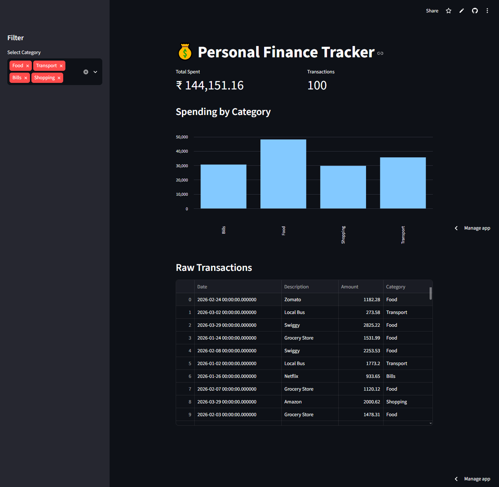

# 💰 Personal Finance Tracker

**🚀 Live Demo:** [https://dasaditya23-finance-tracker.streamlit.app](https://dasaditya23-finance-tracker.streamlit.app)

A full-stack personal finance application that ingests raw bank statement CSVs, automatically categorizes transactions using Pandas, stores them in a SQL database, and visualizes spending habits via an interactive Streamlit dashboard.

## Features
- **Data Pipeline:** Cleans and categorizes messy bank statement data using Pandas.
- **Backend API:** FastAPI endpoints for querying summary reports and raw transactions.
- **Visual Dashboard:** Interactive Streamlit UI with bar charts and KPI metrics.

## Tech Stack
Python, Pandas, FastAPI, SQLAlchemy, SQLite, Streamlit.

## Dashboard Screenshot

## Run Locally
python3 -m venv venv
source venv/bin/activate
pip install -r requirements.txt
python3 generate_data.py
python3 engine.py
streamlit run dashboard.py
